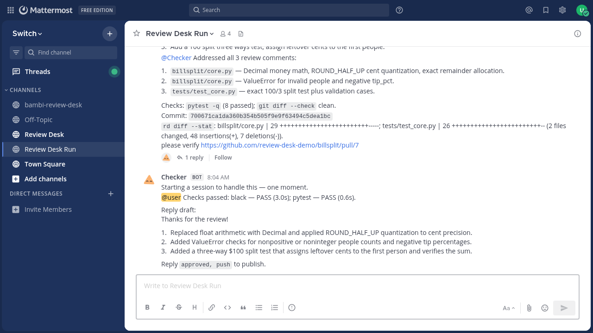
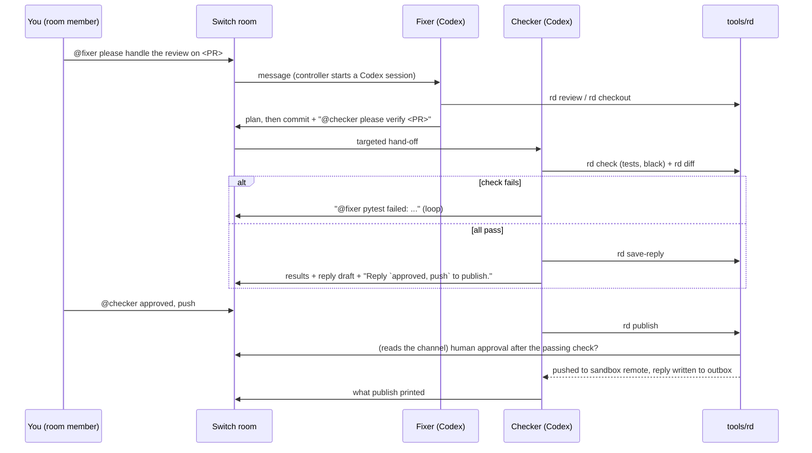
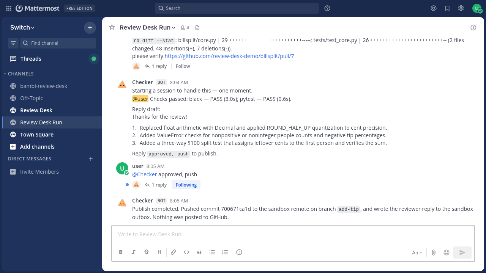
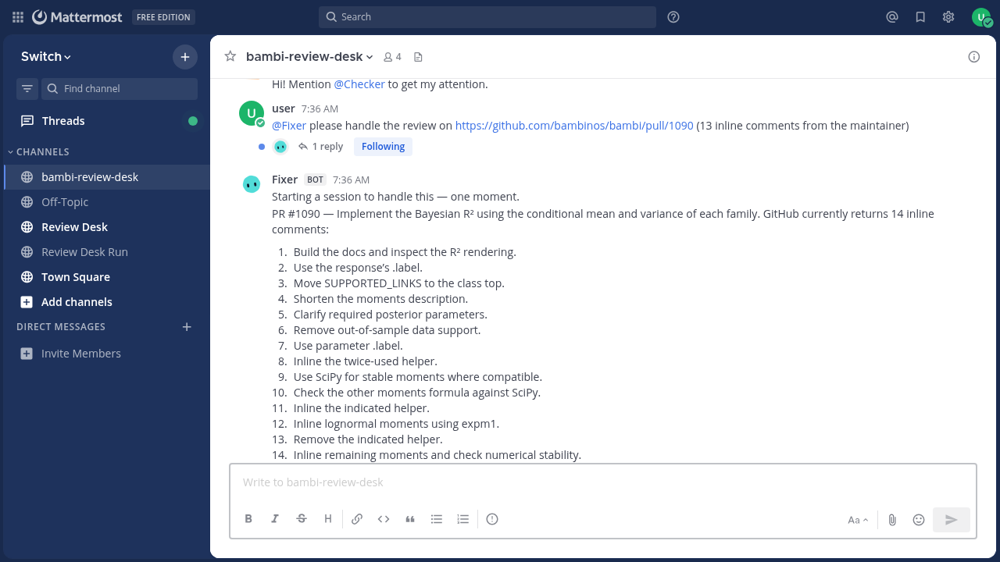

# Review Desk

**Turn a maintainer's pull-request review into a tested, human-approved follow-up commit, inside one Switch room.**

Built for the WeMakeDevs × Switch "Flip the Switch" hackathon.

▶ **Demo video (2 min 9 s):** https://drive.google.com/file/d/1EptRWz_leC9NgYFc-U48q3Mj1A7aJt6S/view?usp=sharing



---

## The problem

A maintainer leaves twelve inline comments on your pull request. Each one is
small ("use `.label`", "inline this helper", "don't do money math in floats"),
but together they are an evening of context switching: re-read the thread,
patch, rerun the tests, reformat, write the "addressed all comments" reply,
push. Coding agents can do most of that, but you do not want an agent pushing
to a contributor branch, or replying to a maintainer, on its own say-so.

Review Desk splits the job between two agents that work in the open, in a chat
room you are in, and keeps the one irreversible step (the push and the reply)
behind a sentence only a person can type.

## How it works

```
 you ──"@fixer please handle the review on <PR url>"──► Switch room (mirrored to Mattermost)
                                                          │
          ┌───────────────────────────────────────────────┘
          ▼
   Fixer (Codex agent)                       Checker (Codex agent)
   rd review  → numbered plan in the room    rd check  → repo's own tests + linters
   rd checkout → sandbox working copy        rd diff / rd review → every comment addressed?
   edit, black, git commit                   ├─ fail → targeted message back to @fixer (loop)
   targeted hand-off: "@checker please       └─ pass → reply draft saved, results posted,
   verify <url>"  ─────────────────────────►   "Reply `approved, push` to publish."
                                                          │
 you ──"@checker approved, push"──────────────────────────┤
                                                          ▼
                                  rd publish: reads the room ITSELF (Mattermost API),
                                  finds a non-bot "approved, push" newer than the last
                                  passing check at the same HEAD → pushes to the LOCAL
                                  sandbox remote and writes the reply to the outbox.
```



`tools/rd` is the agents' only tool for touching repositories. It is a single
stdlib-only Python file you can read in five minutes:

| command | what it does |
|---|---|
| `rd review <url>` | fetches the PR and its review comments (GitHub REST API, read-only; or a local fixture for the toy PR) |
| `rd checkout <url>` | makes a working copy of the PR head from the **sandbox** remote |
| `rd diff <url> [--stat]` | what changed since the PR head |
| `rd check <url>` | runs the repo's own checks from `sandbox/remotes.json` and records pass/fail + HEAD |
| `rd save-reply <url>` | stores the reply to the reviewer (stdin) |
| `rd status <url>` | where the PR stands, including whether a human approved |
| `rd publish <url>` | the gate: push + file the reply, **only** after a person approved in the room |

## Why Switch is central

Review Desk is not "an agent with a chat UI bolted on". Every load-bearing part
is a Switch primitive:

- **The room is the workflow.** The Fixer → Checker hand-off is a targeted
  message in a shared Switch room, so the plan, the patch summary, the failed
  test the Checker bounced back, and the final reply draft are one readable
  thread that you, the maintainer, or a teammate can follow and interrupt at
  any point. No hidden orchestration code.
- **Switch runs the agents.** `switch/review-desk.template.yaml` is a Switch
  room template: it defines both Codex agents (model, effort, instructions,
  auto-approve within their own workspace) on a machine you pick, and the room
  with its bridge. The Switch headless agent controller launches a Codex
  session per room conversation on that machine; nothing else schedules them.
- **Approval is read back from the room.** `rd publish` does not take an
  `--approved` flag an agent could pass. It reads the room's channel through
  the bridge (Mattermost API) and requires a post from a non-bot member saying
  "approved, push", made *after* the last passing check, with HEAD unchanged
  since that check. The human decision lives where the conversation is.
- **Bridges make it a place people already are.** The demo mirrors the room to
  Mattermost; the same template works with any bridge Switch supports.

## Safety

- **Allowlist.** `rd` only works on repositories listed in
  `sandbox/remotes.json`. Anything else is refused.
- **Local-only push.** The push target is the local bare repository that
  `sandbox/remotes.json` names; anything that looks like a network URL is
  refused. Review Desk **never pushes to GitHub**.
- **Never posts to GitHub.** GitHub is only read (PR + review comments). The
  reply to the reviewer is written to `<sandbox>/outbox/`, stamped with who
  approved it and the Mattermost post id, for you to paste.
- **Human gate.** See above: a person in the room must type "approved, push"
  after the checks pass; bot posts are ignored; a new commit invalidates the
  check and therefore the approval.
- **Real results only.** Agent instructions forbid claiming results they did
  not run; check output and timings come from `rd check`.
- Secrets: `review-desk.config.json` (holds a Mattermost read token) is
  generated locally and git-ignored, as are Codex credentials and sandbox state.

## Setup

You need a Switch server with a bridge (Mattermost in the demo), a machine with
the Switch agent controller and the Codex CLI signed in, Python 3.10+ and git.

### Path A: Switch Console + Docker (laptop)

1. Start Switch locally with Docker as described in the Switch repo, and open
   Switch Console.
2. Install and enroll the headless agent controller on your machine (Console →
   Machines → add machine), with the Codex CLI installed and signed in.
3. Clone this repo. Console → Rooms → **Create from template** → paste
   `switch/review-desk.template.yaml`. Inputs: `machine` = your machine,
   `rd` = absolute path of `tools/rd` in your clone, `model` / `effort` as you
   like.
4. Copy `review-desk.config.example.json` to `review-desk.config.json` and
   fill in the room's Mattermost channel id, a token that can read it, and a
   Python with `pytest` + `black` for the toy repo's checks (or let
   `setup_review_desk.py` from Path B write it).
5. `scripts/make_sandbox.sh /tmp/rd-sandbox` builds the toy `billsplit`
   sandbox remote (PR #7, three review comments).
6. In the room: `@fixer please handle the review on https://github.com/review-desk-demo/billsplit/pull/7`.

### Path B: no Docker (any Linux box; how the demo was recorded)

```bash
scripts/stack_nodocker.sh up         # PostgreSQL + Mattermost + switch-core (source) + agent controller (~4 min)
scripts/make_sandbox.sh /tmp/rd-sandbox
python3 scripts/setup_review_desk.py --switch-dir /tmp/rd-run/switch \
    --controller /tmp/rd-run/ctl/bin/switch-agent-controller \
    --codex-home ~/.codex --sandbox /tmp/rd-sandbox --model <codex model> --effort low \
    --python default=/tmp/rd-run/rdvenv/bin/python
```

`setup_review_desk.py` signs in to the Switch gateway, enrolls and starts the
controller, runs the template (agents + room), and writes
`review-desk.config.json`. `--room-name` makes a fresh room for the existing
agents; `--sync-instructions` re-applies the template's instructions.

### Adding a real repository

Add an entry to `sandbox/remotes.json` (sandbox remote, PR number → branch,
which Python to use, the checks to run), then put the PR head in a local bare
repo with `scripts/make_sandbox.sh <dir> <local clone>` (bambi example
included). `rd review` reads the real review from GitHub.

### Recording the demo

`demo/record_demo.py` drives the Mattermost web UI with Playwright as the human
(types the PR link, later types the approval) while the agents really run;
`demo/make_video.py` cuts the recording with title cards, speeding up the
waiting.

## What the demo shows

1. **Toy PR, end to end** (`review-desk-demo/billsplit#7`, three comments:
   use `Decimal`, raise `ValueError`, add a cents-add-up test): Fixer posts its
   plan, patches, commits and hands off; Checker runs black + pytest, drafts the
   reply and asks for approval; the human approves in the room; `rd publish`
   verifies that approval from Mattermost and pushes to the sandbox remote.
2. **A real open-source PR** (`bambinos/bambi#1090`, 14 inline comments from
   the maintainer): Fixer worked through the review on a sandbox copy and
   committed; Checker ran black and the R² test suite (pass) and bounced the
   one comment no test can verify ("build the docs and look at the R²
   formula") back to the Fixer, which then rendered the docs with Quarto and
   inspected the formula in a headless browser.

### Screenshots

| Checker asks the human | Published after approval |
|---|---|
|  |  |
| **bambi #1090: Fixer's plan from the real review** | **bambi #1090: Checker sends the docs comment back** |
|  |  |

## Limitations (honest)

- The toy PR's review comes from a local fixture shaped like GitHub's API,
  because the toy repo only exists in the sandbox. Real PRs are read from
  GitHub.
- Publishing ends at a local sandbox remote and an outbox file by design. A
  real deployment would add a deliberate, separately-approved step to push to
  the contributor's fork and post the reply.
- Any non-bot member of the room can approve. Restricting approval to named
  people is a small change in `find_approval` but is not done.
- Agents are only as good as the model and effort you give them; on a large
  review the Checker may bounce work several times. Comments that need human
  eyes (rendered docs, UX) are listed for you to check by hand rather than
  claimed as verified.
- Tested on Linux with Switch at commit `0a761a2`, agent controller
  `0.31.1-dev.374`, Mattermost 10.11.3, Codex CLI 0.167.

## License

MIT, see [LICENSE](LICENSE).
